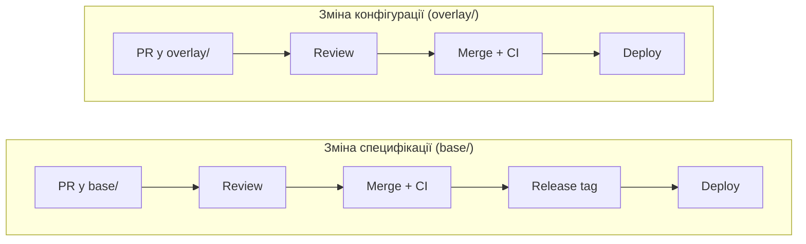

<div align="center">

# eHealth API Docs

**API‑документація ЕСОЗ**

<br/>

[](https://docs.ehealth.gov.ua)
[](https://docs-preprod.ehealth.gov.ua)
[](https://docs-demo.ehealth.gov.ua)
[](https://docs-stage.ehealth.gov.ua)


[Модель](#модель) · [Структура](#структура) · [Гілки](#гілки--середовища) · [Оновлення контенту](#оновлення-контенту)

</div>

<br/>

## Модель

<p align="center">
  
</p>

| Папка | Що це |
|---|---|
| **`base/`** | OpenAPI кожного сервісу для кожного середовища. |
| **`overlay/`** | Конфіг шар поверх `base/`: gov IDs, badges, description, version. Дані з ключем `(service, METHOD, path)`. |
| **`dist/<env>/`** | Згенеровані артефакти, які публікує сайт. |

## Гілки = середовища

Кожне середовище деплоїться на власний хост.

| Гілка | Середовище | Docs URL |
|---|---|---|
| `env/prod` | **PROD** | https://docs.ehealth.gov.ua |
| `env/preprod` | **PREPROD** | https://docs-preprod.ehealth.gov.ua |
| `env/demo` | **DEMO** | https://docs-demo.ehealth.gov.ua |
| `env/stage` | **STAGE** | https://docs-stage.ehealth.gov.ua |

- `main` — інтеграційна (default) гілка, поки що збігається з `env/*`.
- `env/*` захищені: лише PR, без force‑push; кожен реліз — читабельний diff.
- Версії сервісів по середовищах живуть у даних (`base/<service>/<env>.yaml`), а
  не в додаткових гілках: новий сервіс — це нові файли, не нові гілки.

> [!TIP]
> Прев'ю з PR: `https://<PR-number>.docs-<env>.ehealth.gov.ua` — напр. PR 157 у
> гілку `env/demo` → `157.docs-demo.ehealth.gov.ua`.

## Структура

```text
api-docs/
├── base/                         специфікації OpenAPI
│   └── <service>/{prod,preprod,stage,demo}.yaml
│       general-mis · medical-events · ehealth-pis · ehealth-trusted-pis
│
├── overlay/                      ids · badges · description · meta
│
├── dist/
│   └── {prod,preprod,stage,demo}/
│
├── static/                       статичні специфікації БЕЗ середовищ: static/<name>/{index.html,openapi.yaml},
│                                 публікуються лише в PROD за власним шляхом /<name>/ (напр. /man-templates-rendering/)
│
├── portal/
│   ├── index.html                єдина Scalar‑оболонка (віддається на /)
│   ├── assets/                   scalar.standalone.js · fonts/ (e‑Ukraine)
│   └── nginx.conf                референс віддачі: gzip / кеш / CORS
│
├── build/
│   ├── scalar_prebuild/          prebuild.mjs: специфікації → dist/<env>/*.json
│   └── stamp_deploy_badge.sh     ставить "deployed <час>" при деплої
│
└── .github/workflows/            CI: preview + env‑deploy
```

<details>
<summary><b>Нотатки до файлів</b></summary>

<br/>

- **`base/<service>/<env>.yaml`** — OpenAPI 3.1 сервісу.
- **`dist/<env>/<service>.json`** — той самий документ, уже оброблений Scalar
  (bundle, coercion, навігація); саме його вантажить `index.html`, сторінка ~2x
  швидша. Генерується з `base/<service>/<env>.yaml`.
- **`scalar.standalone.js`** підключається як
  `?v=<base>-ehealth-custom.<sha256:8>`: `base` — статична версія апстріму, з якої
  форкнулись; хеш — від вмісту файлу, міняється на кожен реальний білд і б'є кеш
  (`assets/` кешується `Cache-Control: immutable` на рік у `nginx.conf`).

</details>

<details>
<summary><b>Індикатор деплою у верхньому правому куті</b></summary>

<br/>

Індикатор показує час останнього деплою **того сервісу, який зараз відкрито** на
сторінці (`#medical-events`, `#general-mis`, `#ehealth-pis`, `#ehealth-trusted-pis`),
наприклад `deployed 14 Sep 2026 15:30 EEST`. Деплой одного сервісу змінює час лише
в нього: якщо вийшов деплой Medical Events на stage, то на `docs-stage.ehealth.gov.ua`
у PIS час лишається попереднім.

Час сервісу — це час останнього merge в гілку середовища, що змінив його файли
(`base/<service>/<env>.yaml` або `overlay/<service>/`). Він береться з git‑історії
під час деплою, окремо ніде не зберігається. `build/stamp_deploy_badge.sh`
проставляє його в копію `index.html`, яка публікується; сам `index.html` у
репозиторії не змінюється.

Для прев'ю PR сервіси, які змінює цей PR, отримують поточний час.

Усі шляхи в `index.html` відносні, тож сайт працює з будь‑якого шляху на будь‑якому
хості (nginx, CDN, S3, GitHub Pages).

</details>

## Оновлення контенту

Є два окремі процеси: зміна специфікації і зміна конфігурації.



| | Специфікація (`base/`) | Конфігурація (`overlay/`) |
|---|---|---|
| Що змінюється | `base/<service>/<env>.yaml` | gov IDs, badges, description, version |
| Release tag | створюється | **не змінюється** |
| Версія | оновлюється | **не змінюється** |
| Час деплою сервісу | оновлюється | оновлюється |

Тобто зміну в `overlay/` можна замерджити й задеплоїти окремо: вона оновить час
деплою сервісу в індикаторі, але не створить новий реліз і не змінить git‑тег.

Перед PR перегенеруйте `dist/` (потрібен локальний Chrome):

```bash
(cd build/scalar_prebuild && npm ci) && node build/scalar_prebuild/prebuild.mjs . portal/index.html
```

CI на кожен PR перевіряє, що `dist/` відповідає `base/` і `overlay/`; прев'ю
піднімається на коміт, середовище деплоїться на merge.
